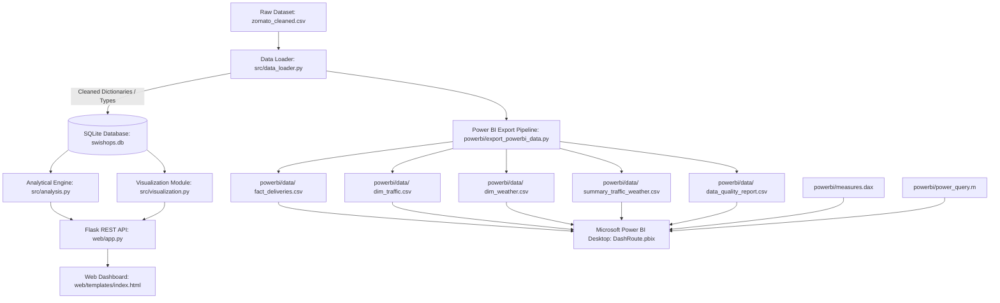

# DashRoute — Delivery Operations Intelligence Platform

An interactive analytics and business intelligence platform designed for understanding food delivery performance, evaluating courier logistics, and identifying operational bottlenecks across weather, traffic, and fleet conditions.

---

## 1. Executive Summary

DashRoute is an end-to-end delivery intelligence system engineered to bridge operational logistics data with executive decision-making. Built with a high-performance Python, SQLite, Flask, and Plotly core alongside a decoupled Microsoft Power BI business intelligence layer, DashRoute transforms raw telemetry records into actionable route and dispatch optimizations.

---

## 2. Problem Statement & Real-World Business Use Case

In quick-commerce and on-demand food delivery networks, delivery latency directly dictates customer retention, courier earnings, and merchant satisfaction. However, delivery friction is rarely uniform:
- **Traffic Congestion Spikes:** Gridlock conditions add non-linear delivery delays that static promise-time algorithms fail to predict.
- **Meteorological Hazards:** Fog, sandstorms, and severe rain impair rider speed, increase safety risks, and inflate cancellation rates.
- **Fleet Degradation:** Suboptimally maintained vehicles silently degrade route velocity across all distance tiers.
- **Holiday & Festival Surges:** Order batching and order-queue saturation during festivals lead to extreme delivery bottlenecks.

**Business Use Case for Product Operations:**
DashRoute enables Product Operations Associates and dispatch managers to:
1. Diagnose root causes of delivery delays with statistical backing.
2. Implement dynamic, condition-aware delivery promise windows (ETAs).
3. Establish safety geofencing and batch caps during adverse weather.
4. Align courier incentives and fleet maintenance standards with trip length.

---

## 3. Key Features

- **Live Operational KPI Strip:** Real-time tracking of total order volume, average trip duration, mean route displacement, courier ratings, and bottleneck ratio.
- **Interactive Multi-Variable Filters:** Dynamic slicing across City Type, Meteorological Condition, Road Traffic Density, and Festival season with instant KPI recalculation.
- **Dual-Axis Traffic Congestion Analysis:** Evaluates average transit duration paired with a slow-delivery percentage trendline across Low, Medium, High, and Jam traffic tiers.
- **Meteorological Velocity Ranking:** Compares trip latency across Sunny, Stormy, Sandstorms, Windy, Cloudy, and Fog conditions with in-bar duration labeling.
- **Cross-Impact Heatmap (Traffic × Weather Matrix):** Cross-tabulates traffic density against weather conditions to uncover compounding latency multipliers, displaying truthful `N/A` markers for unobserved combinations.
- **Distance Tier & Fleet Condition Analytics:** Segments trip duration and bottleneck rates across distance brackets (`< 3 km`, `3–8 km`, `8–15 km`, `> 15 km`) and vehicle maintenance conditions (0: Poor, 1: Fair, 2: Good).
- **High-Risk Bottleneck Registry:** Identifies recurring operational condition combinations exhibiting the highest latency penalty (filtered for statistical significance, sample size &ge; 50).
- **Actionable Strategic Recommendations:** Formulates prioritized interventions (ETA adjustment multipliers, weather geofencing, maintenance auditing) with estimated operational impacts.
- **Microsoft Power BI Reporting Layer:** Companion dimensional model, automated export ETL, DAX measure library, and 4-page report design specification.

---

## 4. Technology Stack

- **Backend & Data Pipeline:** Python 3.12, Standard Library (`csv`, `sqlite3`, `hashlib`, `datetime`)
- **Database Layer:** SQLite 3 (`swishops.db` with B-tree indexes on city, weather, traffic, speed, and festival)
- **Web Application & REST API:** Flask 3.1
- **Visualization Engine:** Plotly.js 2.35, Plotly Python 7.1
- **Frontend Architecture:** Vanilla HTML5, CSS3 (Custom Dark Glassmorphic Design System), Modern JavaScript (ES6+)
- **Business Intelligence & Reporting:** Microsoft Power BI Desktop, DAX, Power Query (M)
- **Automated Testing:** Pytest 9.1

---

## 5. System Architecture & Data Flow



---

## 6. Repository Folder Structure

```
food_distr_analysis/
├── zomato_cleaned.csv          # Real dataset (38,964 delivery records)
├── dataset_profile.txt         # Verified dataset diagnostic profile
├── diagnose_and_profile.py     # Diagnostic and schema inspection utility
├── requirements.txt            # Python package requirements
├── swishops.db                 # Indexed SQLite operational database
├── src/
│   ├── __init__.py             # Package initialization
│   ├── data_loader.py          # CSV discovery, type casting, validation
│   ├── sqlite_layer.py         # SQLite schema, indexing, parameterized queries
│   ├── analysis.py             # Statistical calculations, bottlenecks, recommendations
│   └── visualization.py        # Plotly chart generators with responsive dark layouts
├── web/
│   ├── app.py                  # Flask application serving web dashboard & REST APIs
│   └── templates/
│       └── index.html          # DashRoute interactive executive web dashboard
├── powerbi/
│   ├── README.md               # Power BI Desktop assembly and configuration guide
│   ├── export_powerbi_data.py  # Automated export pipeline for Star-Schema tables
│   ├── data_dictionary.md      # Field specifications, data types, and business logic
│   ├── dashboard_design.md     # 4-page report design & canvas layout specifications
│   ├── measures.dax            # Verified production DAX measures library
│   ├── power_query.m           # Power Query M scripts for data import and typing
│   └── data/                   # Generated analysis-ready tables
│       ├── fact_deliveries.csv
│       ├── dim_traffic.csv
│       ├── dim_weather.csv
│       ├── summary_traffic_weather.csv
│       ├── data_quality_report.csv
│       └── export_metadata.json
└── tests/
    └── test_swishops.py        # Automated test suite (10 tests, 100% pass)
```

---

## 7. Dataset Details

The application operates on the real delivery dataset (`zomato_cleaned.csv`) located in the project root:
- **Total Records:** `38,964` completed deliveries
- **Total Attributes:** `22` verified columns
- **Duplicate Records:** `0` (clean primary key distribution)
- **Completeness Rate:** `99.78%` across all attribute cells

### Verified Schema & Data Dictionary

| Column Name | Inferred Type | Missing Count | Description |
| :--- | :--- | :---: | :--- |
| `ID` | String (Alphanumeric) | 0 | Unique delivery order identifier |
| `Delivery_person_ID` | String | 0 | Unique delivery partner identifier |
| `Delivery_person_Age` | Float | 1,019 (2.61%) | Courier age (years); excluded when missing |
| `Delivery_person_Ratings` | Float | 1,055 (2.71%) | Courier rating (1.0 to 5.0); excluded when missing |
| `Restaurant_latitude` | Float | 0 | Merchant location latitude |
| `Restaurant_longitude` | Float | 0 | Merchant location longitude |
| `Delivery_location_latitude`| Float | 0 | Customer drop-off latitude |
| `Delivery_location_longitude`| Float | 0 | Customer drop-off longitude |
| `Order_Date` | String | 0 | Date order placed (`DD-MM-YYYY`) |
| `Time_Orderd` | String | 835 (2.14%) | Timestamp customer ordered (`HH:MM`) |
| `Time_Order_picked` | String | 0 | Timestamp order picked up (`HH:MM`) |
| `Weather_conditions` | String | 0 | Meteorological condition (6 categories) |
| `Road_traffic_density` | String | 0 | Congestion level (`Low`, `Medium`, `High`, `Jam`) |
| `Vehicle_condition` | Integer | 0 | Vehicle maintenance tier (0: Poor, 1: Fair, 2: Good) |
| `Type_of_order` | String | 0 | Order category (`Snack`, `Meal`, `Drinks`, `Buffet`) |
| `Type_of_vehicle` | String | 0 | Modality (`motorcycle`, `scooter`, `electric_scooter`, `bicycle`) |
| `multiple_deliveries` | Float | 0 | Bundled delivery count on trip (`0.0` to `3.0`) |
| `Festival` | String | 0 | Holiday/festival indicator (`No`, `Yes`) |
| `City` | String | 0 | City tier (`Metropolitian`, `Urban`, `Semi-Urban`) |
| `Time_taken (min)` | Integer / Float | 0 | **Target Metric:** Trip duration from pickup to drop-off |
| `distance_km` | Float | 0 | Geodesic displacement in kilometers |
| `delivery_speed` | String | 0 | Velocity classification (`Fast`, `Average`, `Slow`) |

---

## 8. Installation & Setup Instructions (Windows)

### Prerequisites
- Python 3.10+ (Python 3.12 recommended)
- Windows PowerShell or Command Prompt

### Step 1: Clone or Open the Repository
```powershell
cd E:\food_distr_analysis
```

### Step 2: Set Up the Virtual Environment
If using the existing project virtual environment:
```powershell
.\venv\Scripts\Activate.ps1
```
*(Or create a new environment if setting up on a fresh machine):*
```powershell
python -m venv venv
.\venv\Scripts\Activate.ps1
```

### Step 3: Install Required Dependencies
```powershell
.\venv\Scripts\python.exe -m pip install -r requirements.txt
```

---

## 9. Launching the DashRoute Application

Start the Flask web server:
```powershell
.\venv\Scripts\python.exe web\app.py
```

Expected terminal output:
```
==================================================
>> DashRoute Dashboard starting on http://127.0.0.1:5000
==================================================
 * Running on http://127.0.0.1:5000
```

---

## 10. Accessing the Local Dashboard

Once the server is running, open any modern web browser to:
```
http://127.0.0.1:5000
```

### Verified API Endpoints

| Endpoint | Method | Response Description |
| :--- | :---: | :--- |
| `/` | `GET` | Serves the interactive executive HTML dashboard |
| `/api/health` | `GET` | Service status: `{"service": "DashRoute Analytics API", "status": "healthy"}` |
| `/api/filters` | `GET` | Distinct dropdown values for cities, weather, traffic, and festivals |
| `/api/kpis` | `GET` | Overall or filtered KPIs (`?city=&weather=&traffic=&festival=`) |
| `/api/charts` | `GET` | Plotly JSON specifications for all 5 interactive figures |
| `/api/summary` | `GET` | Comprehensive statistical summary, insights, and recommendations |
| `/api/bottlenecks`| `GET` | Top 10 high-risk operational bottleneck combinations |

---

## 11. Running Automated Tests

DashRoute includes an automated Pytest test suite covering data discovery, parsing integrity, SQLite operations, SQL aggregations, Plotly structures, API status codes, and Power BI export consistency.

Run the test suite:
```powershell
.\venv\Scripts\python.exe -m pytest tests/test_swishops.py -v
```

### Verified Test Results
```
tests/test_swishops.py::test_dataset_location PASSED                     [ 10%]
tests/test_swishops.py::test_data_loader_parsing PASSED                  [ 20%]
tests/test_swishops.py::test_sqlite_db_initialization PASSED             [ 30%]
tests/test_swishops.py::test_sql_kpi_queries PASSED                      [ 40%]
tests/test_swishops.py::test_traffic_weather_matrix PASSED               [ 50%]
tests/test_swishops.py::test_bottleneck_segments PASSED                  [ 60%]
tests/test_swishops.py::test_analytical_summary_and_recommendations PASSED [ 70%]
tests/test_swishops.py::test_visualization_charts PASSED                 [ 80%]
tests/test_swishops.py::test_flask_api_endpoints PASSED                  [ 90%]
tests/test_swishops.py::test_powerbi_exports_and_consistency PASSED      [100%]

============================= 10 passed in 5.65s ==============================
```

---

## 12. Microsoft Power BI Companion Layer

DashRoute features a decoupled enterprise reporting architecture designed for Microsoft Power BI Desktop.

### What is Completed & Verified:
1. **Automated Export Pipeline (`powerbi/export_powerbi_data.py`):** Slices the master dataset into analysis-ready fact and dimension CSV files stored in `powerbi/data/`.
2. **Metadata & Lineage Tracking (`powerbi/data/export_metadata.json`):** Tracks record counts, column types, and SHA-256 source file hash checksums.
3. **Data Dictionary (`powerbi/data_dictionary.md`):** Complete field specifications, data types, nullability rules, and business definitions.
4. **4-Page Report Design Specification (`powerbi/dashboard_design.md`):** Visual placement, canvas coordinates, chart types, color tokens, and slicer configurations for:
   - **Page 1:** Executive Overview (Volume, Avg Duration, P90, Threshold Ratios, Duration Histogram)
   - **Page 2:** Delivery Performance (Traffic, Weather, Vehicle Condition, Distance Brackets)
   - **Page 3:** Root Cause Analysis (Traffic × Weather Matrix, Bottleneck Registry, Interventions)
   - **Page 4:** Data Quality & Governance (Completeness Scorecard, Missing Value Audit)
5. **DAX Measure Library (`powerbi/measures.dax`):** Validated formulas for `[Total Deliveries]`, `[Average Delivery Duration]`, `[Median Delivery Duration]`, `[P90 Delivery Duration]`, `[% Above 30 Min]`, `[Congestion Latency Penalty]`, and `[Festival Impact Penalty]`.
6. **Power Query M Scripts (`powerbi/power_query.m`):** Reusable M code for parameter-driven ingestion and type casting.

### Generating or Refreshing Power BI Data:
```powershell
.\venv\Scripts\python.exe powerbi/export_powerbi_data.py
```

### Steps to Open in Microsoft Power BI Desktop:
1. Open **Power BI Desktop** &rarr; click **Get Data &rarr; Text/CSV**.
2. Select files from `powerbi/data/` (`fact_deliveries.csv`, `dim_traffic.csv`, `dim_weather.csv`, `summary_traffic_weather.csv`, `data_quality_report.csv`).
3. Connect `dim_traffic` and `dim_weather` to `fact_deliveries` using 1-to-Many relationships.
4. Paste the DAX measures from `powerbi/measures.dax`.
5. Assemble the visuals according to `powerbi/dashboard_design.md` and save as `DashRoute.pbix`.

---

## 13. Key Analytical Findings & Operational Insights

Directly derived from the 38,964 delivery records:

1. **Traffic Congestion Latency:**
   - Orders in **Jam** traffic average **31.44 minutes** vs. **21.50 minutes** in **Low** traffic (**+9.94 minute penalty**).
   - **55.2%** of Jam orders fall into the `Slow` speed classification.
2. **Adverse Weather Friction:**
   - **Fog** and **Stormy** conditions average **29.22 minutes** vs. **22.20 minutes** under **Sunny** conditions (**+7.02 minute adverse weather penalty**).
3. **Fleet Maintenance Degradation:**
   - Vehicles in **Condition 0 (Poor)** average **30.2 minutes** per trip compared to **24.7 minutes** for **Condition 2 (Good)**, adding an average of **5.5 minutes** per delivery across all distance tiers.
4. **Festival Surge Bottlenecks:**
   - Festival periods average **45.47 minutes** transit time with a **100% slow delivery rate**, caused by order batching and courier backlog.

---

## 14. Current Limitations & Future Roadmap

- **Customer Promise Times (SLAs):** The underlying dataset captures actual duration from pickup to drop-off, but does not record customer-promised delivery windows (contract ETAs). Therefore, latency is benchmarked against operational thresholds (`> 30 mins` or `delivery_speed = 'Slow'`) rather than contractual customer breach rates.
- **Kitchen Preparation Latency:** Food preparation time is uncoupled from transit time in the source telemetry.
- **Correlation vs. Causation:** While traffic and weather exhibit clear statistical penalties, multi-variable interactions (e.g. local road geometry, courier supply density during storms) also contribute to trip variance.
- **Future Improvements:**
  - Implementation of a real-time machine learning inference endpoint (e.g. XGBoost/LightGBM) to predict trip duration dynamically at checkout.
  - Automated deployment with Docker and CI/CD pipelines (GitHub Actions).
  - Integration of live OpenStreetMap / Mapbox route polyline visualizations.

---

## 15. License & Portfolio Attribution

Developed by a Software Engineering Graduate for the **Product Operations Associate** role. Built with verified data integrity, transparent statistical methodology, and industry-standard architecture.
