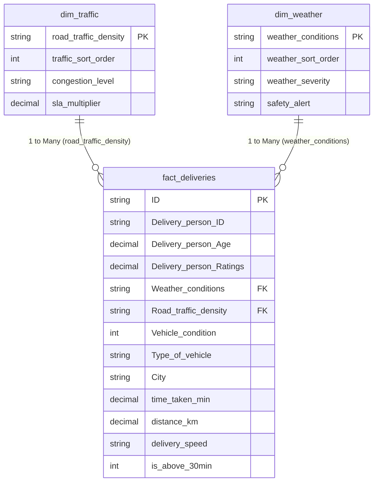

# DashRoute Power BI Executive Report Specification

This specification provides the design, visual layout, data modeling, and UX guidelines for the 4-page enterprise Power BI report (`DashRoute.pbix`).

---

## 🎨 Theme & Visual Design Tokens

- **Canvas Size:** 16:9 Standard (1920 × 1080 px or 1280 × 720 px)
- **Background Color:** `#0F172A` (Slate Dark Navy)
- **Card / Visual Container Background:** `#1E293B` (Slate 800) with 1px border `#334155`
- **Typography:**
  - Header / KPI Numbers: `Segoe UI Semibold` or `DIN` (Color: `#FFFFFF`)
  - Subheaders / Labels: `Segoe UI` (Color: `#94A3B8`)
- **Accent Color Palette:**
  - Primary / Brand: `#6366F1` (Indigo)
  - Secondary / Accent: `#06B6D4` (Cyan)
  - Success / Fast: `#10B981` (Emerald)
  - Warning / Moderate: `#F59E0B` (Amber)
  - Danger / Latency / Slow: `#EF4444` (Rose / Red)

---

## 🔗 Star Schema Data Model & Relationships

- **Relationships:**
  1. `dim_traffic[road_traffic_density]` 1 &rarr; Many `fact_deliveries[Road_traffic_density]` (Single direction filter, Active)
  2. `dim_weather[weather_conditions]` 1 &rarr; Many `fact_deliveries[Weather_conditions]` (Single direction filter, Active)
- **Column Sorting Configurations:**
  - Set `dim_traffic[road_traffic_density]` &rarr; **Sort by Column** &rarr; `dim_traffic[traffic_sort_order]`
  - Set `dim_weather[weather_conditions]` &rarr; **Sort by Column** &rarr; `dim_weather[weather_sort_order]`
  - Set `fact_deliveries[distance_tier]` &rarr; **Sort by Column** &rarr; `fact_deliveries[distance_tier_order]`

---

## 📄 Page 1: Executive Overview

**Objective:** High-level executive pulse on delivery operations, overall order throughput, duration benchmarks, and SLA threshold violations.

### Layout & Visual Grid:
1. **Top Header & Global Slicer Strip (Y: 0 – 120px):**
   - Title: `DashRoute — Executive Operations Overview`
   - Subtitle: `Active fleet telemetry tracking 38,964 delivered orders across multiple metropolitan hubs`
   - Slicers: `City` (Dropdown), `Festival` (Button/Tile: All, Yes, No), `Date Range` (Between slicer)
2. **KPI Card Ribbon (Y: 130 – 250px):**
   - **Card 1 (Total Volume):** Measure `[Total Deliveries]` (`38,964 orders`)
   - **Card 2 (Average Duration):** Measure `[Average Delivery Duration]` (`26.58 mins`)
   - **Card 3 (Median Duration):** Measure `[Median Delivery Duration]` (`26.00 mins`)
   - **Card 4 (90th Percentile):** Measure `[P90 Delivery Duration]` (`38.00 mins`)
   - **Card 5 (Threshold Violations):** Measure `[% Above 30 Min]` (`34.8% orders > 30 mins`)
   - **Card 6 (Mean Satisfaction):** Measure `[Average Courier Rating]` (`4.63 / 5.0`)
3. **Primary Visual 1 (Left 60% Width, Y: 270 – 680px):**
   - **Visual Type:** Histogram / Clustered Column Chart
   - **Title:** `Delivery Duration Distribution (Minutes)`
   - **X-Axis:** `time_taken_min` (Grouped into 5-minute bins: 10-15, 15-20, 20-25, 25-30, 30-35, 35-40, 40-45, 45+)
   - **Y-Axis:** `[Total Deliveries]`
   - **Color:** `#6366F1` with benchmark line at 30 minutes (`#EF4444`)
4. **Primary Visual 2 (Right 40% Width, Y: 270 – 680px):**
   - **Visual Type:** Donut Chart / Semi-Circle Gauge
   - **Title:** `Delivery Velocity Breakdown`
   - **Legend:** `delivery_speed` (`Fast`, `Average`, `Slow`)
   - **Values:** `[Total Deliveries]`
   - **Colors:** Fast (`#10B981`), Average (`#06B6D4`), Slow (`#EF4444`)

---

## 📄 Page 2: Delivery Performance

**Objective:** In-depth evaluation of delivery durations across operational segments: road traffic density, weather conditions, vehicle maintenance, and distance tiers.

### Layout & Visual Grid:
1. **Visual 1 (Top Left, 50% Width):**
   - **Visual Type:** Line and Clustered Column Chart
   - **Title:** `Delivery Duration & Delay Ratio by Road Traffic Density`
   - **X-Axis:** `dim_traffic[road_traffic_density]` (Sorted: Low &rarr; Med &rarr; High &rarr; Jam)
   - **Column Y-Axis:** `[Average Delivery Duration]` (Bar color: `#6366F1`)
   - **Line Y-Axis:** `[% Slow Delivery Rate]` (Line color: `#EF4444`, Stroke: 3px)
   - **Insight:** Highlights the +9.9 minute penalty incurred in Jam traffic (31.44m vs 21.50m).
2. **Visual 2 (Top Right, 50% Width):**
   - **Visual Type:** Clustered Bar Chart (Horizontal)
   - **Title:** `Average Transit Duration by Meteorological Condition`
   - **Y-Axis:** `dim_weather[weather_conditions]` (Sorted: Sunny &rarr; Stormy &rarr; Sandstorms &rarr; Windy &rarr; Cloudy &rarr; Fog)
   - **X-Axis:** `[Average Delivery Duration]`
   - **Data Labels:** ON, formatted as `0.0 mins`
   - **Color Gradient:** `#10B981` (Sunny: 22.2m) to `#EF4444` (Fog: 29.2m)
3. **Visual 3 (Bottom Left, 50% Width):**
   - **Visual Type:** Clustered Column Chart
   - **Title:** `Trip Duration & Slow Ratio Across Distance Brackets`
   - **X-Axis:** `fact_deliveries[distance_tier]` (Short &rarr; Medium &rarr; Long &rarr; Very Long)
   - **Y-Axis:** `[Average Delivery Duration]`, `[Deliveries Above 30 Min]`
4. **Visual 4 (Bottom Right, 50% Width):**
   - **Visual Type:** Clustered Column Chart
   - **Title:** `Fleet Maintenance Impact: Vehicle Type vs Condition Tier`
   - **X-Axis:** `fact_deliveries[Type_of_vehicle]`
   - **Legend:** `fact_deliveries[vehicle_condition_label]` (Condition 0, 1, 2)
   - **Y-Axis:** `[Average Delivery Duration]`

---

## 📄 Page 3: Root Cause Analysis

**Objective:** Multi-variable regression and bottleneck identification, highlighting adverse condition combinations, sample sizes, and actionable operational mitigations.

### Layout & Visual Grid:
1. **Visual 1 (Top Half, 100% Width):**
   - **Visual Type:** Matrix Visual (Cross-Impact Heatmap)
   - **Source Table:** `summary_traffic_weather` (or `fact_deliveries` with measures)
   - **Rows:** `Road_traffic_density`
   - **Columns:** `Weather_conditions`
   - **Values:** `[Average Delivery Duration]`
   - **Conditional Formatting:** Background color gradient from Green (`#065F46`, 20m) &rarr; Cyan (`#0284C7`) &rarr; Amber (`#D97706`) &rarr; Crimson (`#DC2626`, 35m+)
   - **Missing Combinations:** Blank (displayed as `-`, no fabricated numbers)
2. **Visual 2 (Bottom Left, 55% Width):**
   - **Visual Type:** Table Visual
   - **Title:** `Top 10 High-Risk Bottleneck Segments (Sample Size ≥ 50)`
   - **Columns:** `Road_traffic_density`, `Weather_conditions`, `City`, `Vehicle_condition`, `[Total Deliveries]`, `[Average Delivery Duration]`, `[% Slow Delivery Rate]`
   - **Sorting:** `[Average Delivery Duration]` DESC
3. **Visual 3 (Bottom Right, 45% Width):**
   - **Visual Type:** Card / Infographic Grid
   - **Title:** `Data-Driven Operational Interventions`
   - **Card 1:** Dynamic Congestion SLA Multipliers (+15 to 20 mins for Jam alerts).
   - **Card 2:** Weather Geofencing (cap non-enclosed motorcycle delivery radius to 8km during Fog/Storms).
   - **Card 3:** Fleet Maintenance Incentive (prioritize Condition 2 vehicles for long-distance routes).

---

## 📄 Page 4: Data Quality & Governance

**Objective:** Transparency and data integrity audit, detailing completeness rates, missing-value treatments, and unmeasured operational boundaries.

### Layout & Visual Grid:
1. **Summary KPIs (Top Ribbon):**
   - Total Audited Rows: `38,964`
   - Duplicate Rows: `0 (0.00%)`
   - Overall Attribute Completeness: `99.78%`
2. **Completeness Scorecard Table (Left 60% Width):**
   - **Source:** `data_quality_report`
   - **Columns:** `column_name`, `expected_type`, `missing_count`, `completeness_pct`, `status`, `imputation_handling`
   - **Data Bars:** Green data bars on `completeness_pct` (ranging 97.29% to 100.0%)
3. **Governance & Boundary Callout Box (Right 40% Width):**
   - **Callout 1 (Promised Delivery Times):** Note explaining customer promise ETAs are absent; delay metrics reflect duration benchmarks, not customer contract SLA breaches.
   - **Callout 2 (Restaurant Cooking Latency):** Note explaining merchant prep time is uncoupled from transit telemetry.
   - **Callout 3 (Correlation Disclaimer):** Explicit guidance that weather and congestion represent observable friction, but causality is multi-factorial.
